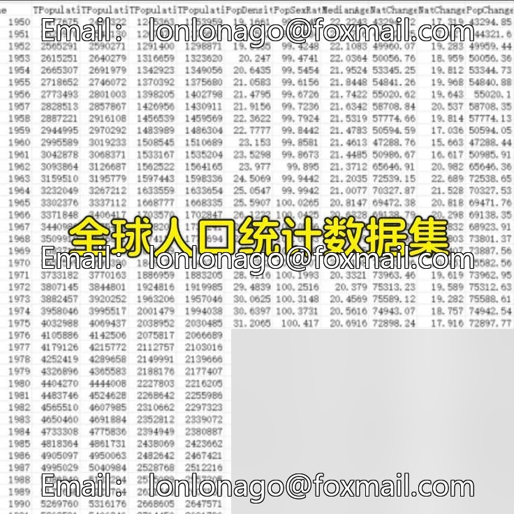
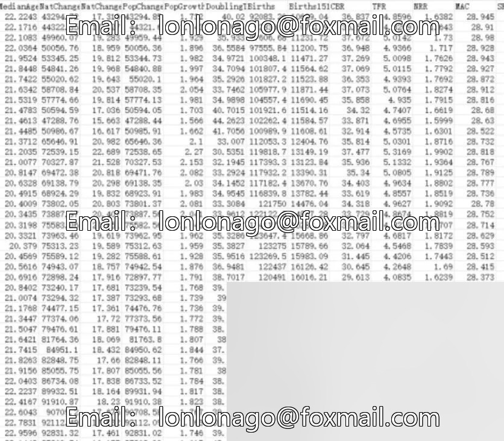
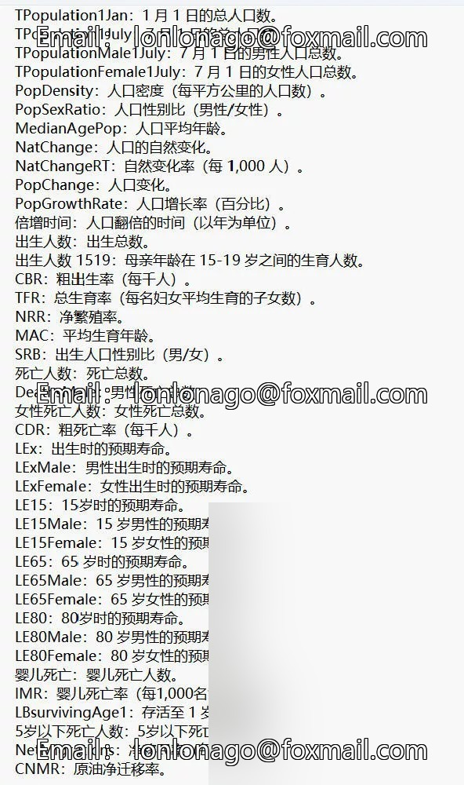

# Global population statistical dataset, providing a comprehensive overview of global population from 2022 to 2025.

## Body

The global population statistics dataset provides comprehensive population statistical information for the global population from 2022 to 2025, reflecting various aspects of population dynamics, including population count, gender ratio, birth rate, death rate, expected life expectancy, and migration patterns.

Explanation:
SortOrder: Sorting number identifier.
PopDensity: Population density (populations per square kilometer).
PopSexRatio: Population sex ratio (male/female).
MedianAgePop: Average population age.
NatChange: Natural population change.
NatChangeRT: Natural change rate (per 1,000 people).
PopChange: Population change.
PopGrowthRate: Population growth rate (percentage).
Double Mitigation Time: Time for population to double (in years).
Birth Count: Total births.

Number of births 1519: number of births where the mother's age was between 15 and 19.

How to use the dataset:
Researchers can analyze population trends, birth rates, and death rates and population growth situations.
Policy makers can use population data to guide decisions regarding healthcare, education, and social services.
Data scientists can visualize and model population dynamics across various regions.
Journalists can use the dataset to report on global population trends and differences.
Educators can incorporate real-world population data into courses and research.

web-based shipment, can be directly photographed and shipped.

The dataset provides comprehensive 2022-2025 global population statistics including population size, sex ratio, birth rate, death rate, median age and migration patterns.

<!-- AI_ENRICHED -->

## Images

## Payment

Here is a pay link on Stripe ( https://buy.stripe.com/3cs8yP7sY87d0vu9AB ). Please contact me lonlonago@foxmail.com after funding $89, and I will send you a complete data files , thank you!

